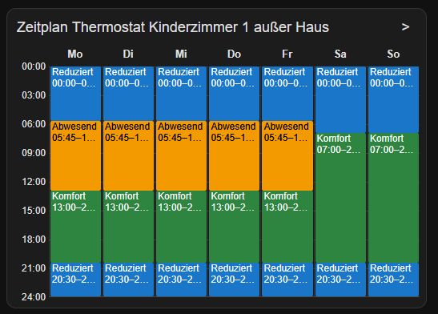
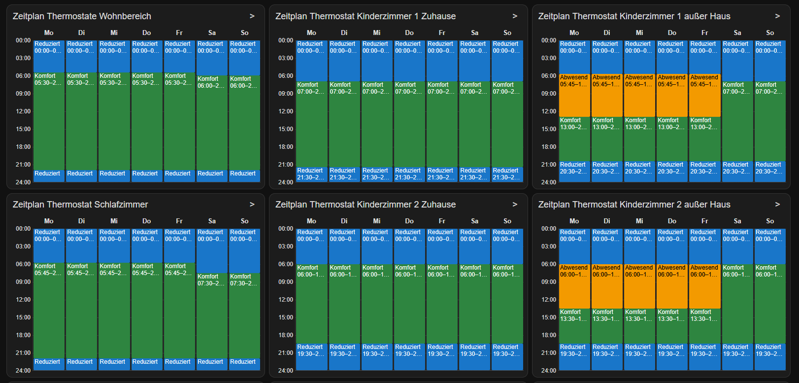
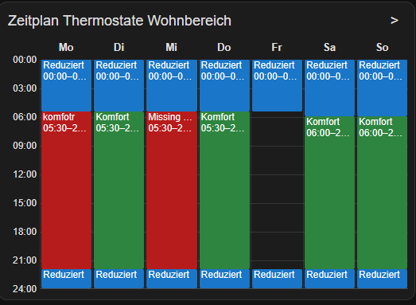
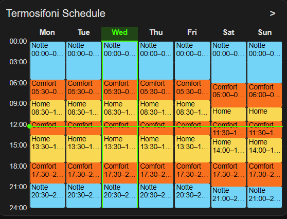

# Minimal Schedule Viewer

Version **0.1.8**. A lightweight Lovelace custom card for native Home Assistant schedule helpers. Shows a compact, color-coded weekly timeline and keeps editing in Home Assistant's standard interface.

## Features

- Monday through Sunday, 00:00–24:00, with ticks every three hours.
- Blocks proportional to duration, with a label and start/end time.
- Matching sections with identical times and data merge across adjacent days into one continuous block.
- Consecutive sections with the same data merge vertically within each day.
- Automatic title from the entity's `friendly_name`.
- Per-card YAML mappings, translated day labels, and visible data errors.
- Light/dark theme support, no dependencies, build step, or animations. HACS installation supported.
- Highlights the current weekday and shows a minute-updated local-time line.

## Installation via HACS

1. Open **HACS** in Home Assistant.
2. Open the menu (three dots) and select **Custom repositories**.
3. Add `https://github.com/ka-ko-sta/minimal-schedule-viewer` as a **Dashboard** repository.
4. Search for **Minimal Schedule Viewer** in HACS and download the latest release.
5. HACS should automatically register the JavaScript resource. If needed, check **Settings → Dashboards → Resources**.
6. Add a manual dashboard card using the YAML example below.

**Note:** If you previously installed the card manually, remove the old `/local/minimal-schedule-viewer.js` entry from your dashboard resources to avoid loading the card twice.

The HACS-managed resource is located at:

`/hacsfiles/minimal-schedule-viewer/minimal-schedule-viewer.js`

Updates can be installed directly through HACS.


## Manual installation

1. Copy `minimal-schedule-viewer.js` to `/config/www/minimal-schedule-viewer.js`.
2. In **Settings → Dashboards → Resources**, add `/local/minimal-schedule-viewer.js?v=0.1.8` as a **JavaScript Module**.
3. Reload your browser and add a manual card using the example below.

Enable Advanced Mode in your user profile if Resources is hidden. If you just created the `www` directory for the first time, restart Home Assistant once. Copy the updated JS file to `/config/www/minimal-schedule-viewer.js`, then hard-reload the browser. When updating again, increment the resource URL's `v` suffix to invalidate cached copies.

Requires a native `schedule.*` entity and a Home Assistant version exposing [`schedule.get_schedule`](https://www.home-assistant.io/actions/schedule.get_schedule/) with response data. The signed-in user needs permission to read that schedule. No `schedule/list` fallback or separate integration is used.

## Dashboard example

```yaml
type: custom:minimal-schedule-viewer
entity: schedule.zeitplan_thermostat_kinderzimmer_1_auser_haus

data_key: modus

days:
  - Mo
  - Di
  - Mi
  - Do
  - Fr
  - Sa
  - So

show_today: true
show_current_time: true

states:
  komfort:
    label: Komfort
    color: "#2e8540"
  reduziert:
    label: Reduziert
    color: "#1976c9"
  abwesend:
    label: Abwesend
    color: "#f39a00"

grid_options:
  columns: 16
  rows: auto
```

**`grid_options: { columns: 16, rows: auto }` is useful for a comfortably wide weekly view.** In a Sections dashboard, ensure the containing section has enough width for 16 columns. Actual placement and the number of cards per row are controlled by your dashboard; this is not a fixed pixel width.

An English example using a different data field:

```yaml
type: custom:minimal-schedule-viewer
entity: schedule.living_room
data_key: mode
states:
  comfort:
    label: Comfort
    color: "#2e8540"
  away:
    label: Away
    color: "#f39a00"
# Omitted days defaults to Mon, Tue, Wed, Thu, Fri, Sat, Sun.
grid_options:
  columns: 16
  rows: auto
```

Both examples are also available in `examples/`.

## Configuration

| Option | Required | Description |
| --- | --- | --- |
| `type` | Yes | `custom:minimal-schedule-viewer` |
| `entity` | Yes | Native `schedule.*` entity |
| `data_key` | Yes | Exact key in each block's `data` object |
| `states` | Yes | Value-to-label/color mapping; `{}` makes all present values unknown |
| `days` | No | Seven non-empty strings, Monday first; defaults to `Mon, Tue, Wed, Thu, Fri, Sat, Sun` |
| `merge_adjacent_days` | No | Merge matching sections across adjacent days; defaults to `true` |
| `merge_adjacent_times` | No | Merge consecutive sections with matching data within a day; defaults to `true` |
| `label_alignment` | No | Align the section label and time text horizontally: `left`, `center`, or `right`; defaults to `left` |
| `label_vertical_alignment` | No | Align the label and time text vertically: `top`, `center`, or `bottom`; defaults to `top` |
| `show_today` | No | Show the current-day highlight; defaults to `true` |
| `show_current_time` | No | Show the current-time line across the week; defaults to `true` |
| `highlight_today_color` | No | Color for the current-day highlight; defaults to Home Assistant's primary color |
| `current_time_color` | No | Color for the current-time line; defaults to Home Assistant's primary color |
| `grid_options` | No | Home Assistant dashboard layout settings |

Set `merge_adjacent_days` to the YAML boolean `false` to keep each day's sections separate; set `merge_adjacent_times` to `false` to keep consecutive same-day sections separate. Both default to `true`. Time sections merge only when one ends exactly as the next begins and their configured data values match, so gaps are preserved. Set either visibility option to the YAML boolean `false` to hide that marker; omit it or set it to `true` to show it. Do not quote boolean values. Marker colors accept `#RGB` or `#RRGGBB`; omit a color to follow the active Home Assistant theme.

Set `label_alignment` to `left`, `center`, or `right` to align the label and time text horizontally; it defaults to `left`. Set `label_vertical_alignment` to `top`, `center`, or `bottom` to position the two lines vertically within each block; it defaults to `top`.

`data_key: modus` reads `data.modus` in each schedule block. It is a literal field name, not a dotted path. For example, a block may contain:

```yaml
from: "05:30:00"
to: "22:00:00"
data:
  modus: komfort
```

Each `states` entry requires a string `label` and a quoted hex `color`: `#RGB` or `#RRGGBB`. Matching is exact and case-sensitive; whitespace is not trimmed for matching. Numeric and boolean block values use their string representation as mapping keys (quote such keys in YAML). Text color is automatically black or white for contrast.

The source-level `TEXT_STYLES` near the top of the JS file exposes `.day_style`, `.hour_style`, `.schedule_name`, and `.schedule_time` for optional typography changes. Standard use requires only YAML configuration.

## Error display

| Condition | Display |
| --- | --- |
| Key absent, null, empty or whitespace-only string | Red block, `Missing value` |
| Present value not listed under `states` | Red block showing the raw value, e.g. `komofrt` |
| Missing/invalid times or an end not later than its start | Red diagnostic above the timeline naming the day and block; no fabricated placement |
| Overlapping blocks | Red blocks and a diagnostic |
| Unavailable entity or failed request | Error message; any retained schedule is explicitly marked as the last loaded data |

Empty space means no configured block. Labels and times truncate horizontally when narrow. The time line is hidden only if the block is too short vertically to show the complete line; the label remains. Block height always stays proportional to duration. Hover for complete details. Blocks are not clickable. Native hover tooltips may not be available on touch-only devices.

## Editing and refresh

The `>` button opens Home Assistant's native entity dialog, the same entry point used by the helper list. Depending on the HA version, choose its edit/settings control to reach the schedule editor. The card does not save anything. YAML-defined schedules remain subject to HA's own editing limitations and permissions.

The current weekday is highlighted, with a line marking the local current time. The clock updates every minute without reloading schedule data. Schedule data reloads on attachment, reconnection, when returning to a visible browser tab, and once after closing the native dialog opened by this card. There is no periodic schedule polling. Edits made elsewhere may require reopening/reloading the dashboard. The native dialog close event is a frontend integration point and may change in future HA releases.

## What this card does NOT do

- No editing.
- No scheduling logic or device control.
- No replacement for Home Assistant's native schedule editor.
- No visual configuration editor, separate schedule storage, or HACS dependency.

## Development

No build step. Run `node --check minimal-schedule-viewer.js` and `node --test minimal-schedule-viewer.test.cjs`. Tests cover configuration, parsing, request handling, and rendering with a simulated HA environment. Manually tested in Firefox, Chrome, and the Home Assistant Companion apps on Android and iOS.

## Screenshots

### Single schedule


### Multi-card overview


### Error detection


### Today and Current time

